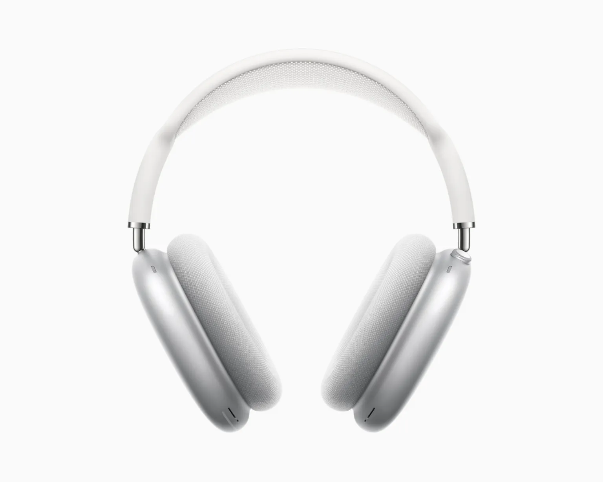
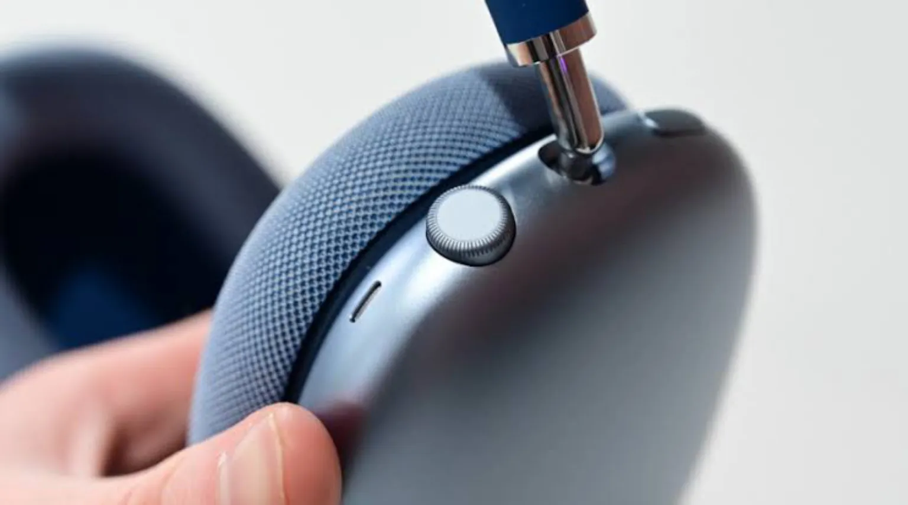
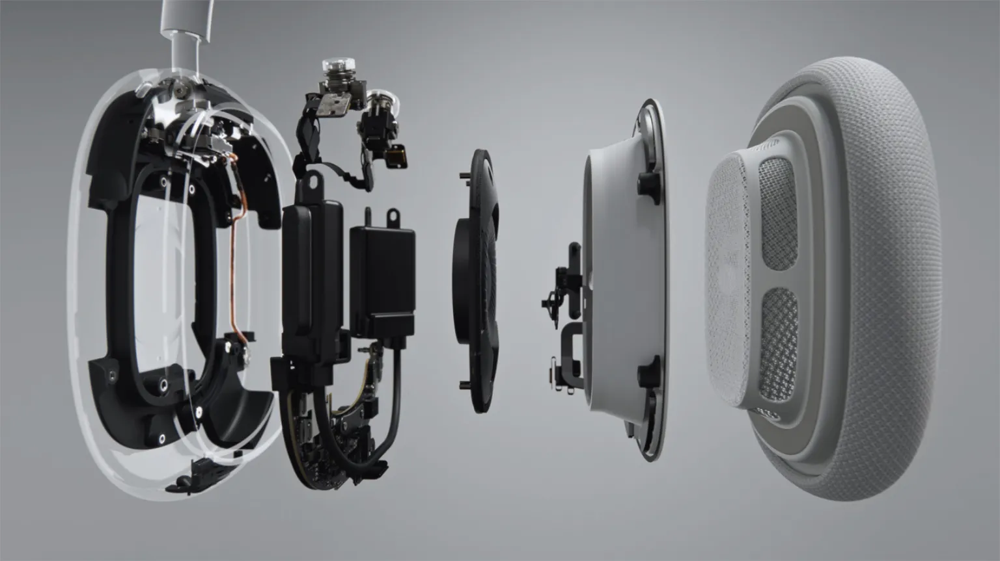
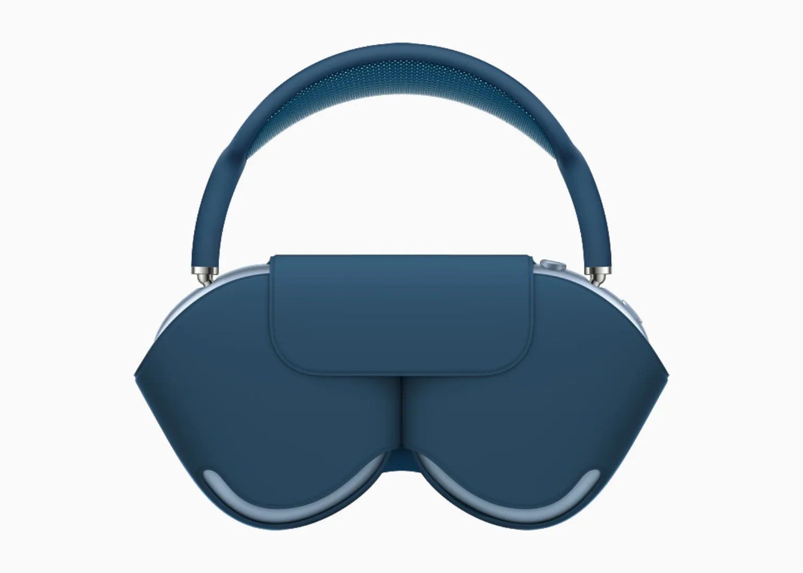

# AirPods Max — Form in Motion

An independent, scroll-driven product study built with HTML, CSS, and a single persistent Three.js scene. The headset, cushions, controls, internal layers, and Smart Case are generated from code; no product model, Spline scene, or 3D embed is loaded.

## Run locally

Serve the dist/ directory from any static web server. The page imports the pinned Three.js runtime from jsDelivr; it does not fetch a model or texture from a remote source.

## Interaction

- Scroll through the seven chapters to scrub the camera, lighting, colorway, cushion, exploded-view, and case animations.
- Select a finish in the color chapter to pin the headset, cushions, canopy, and Smart Case to that color.
- Move the pointer for a restrained parallax tilt.

## Website sections

| Sculpture & finishes | Digital Crown & controls |
|:--:|:--:|
|  |  |

| Knit materials & cushion | Magnetic detach & engineering |
|:--:|:--:|
|  |  |

| Smart Case |
|:--:|
|  |

The internal component geometry is an illustrative reconstruction based on the supplied reference frames and Apple’s published hardware description. It is not service documentation or a reverse-engineered CAD model.
