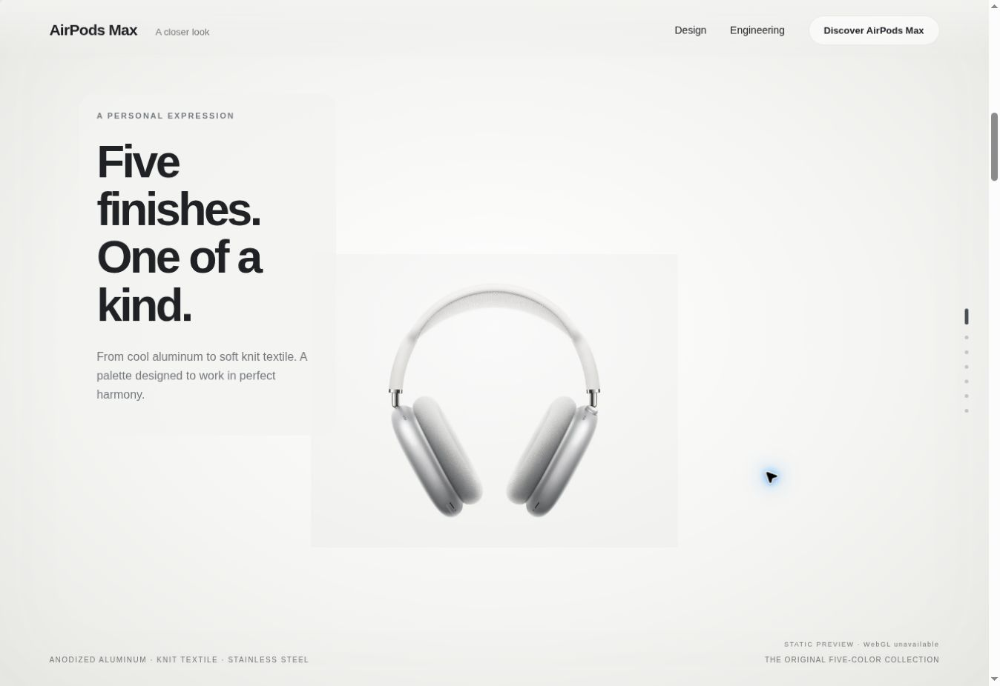
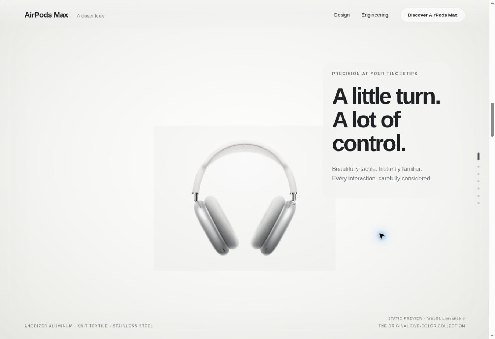
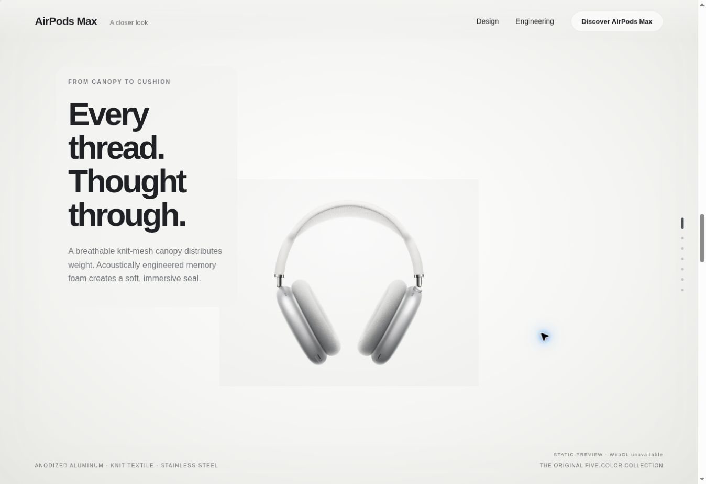
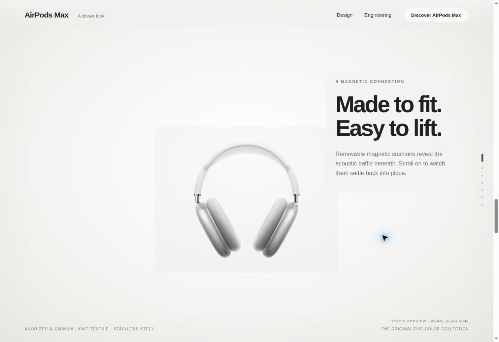
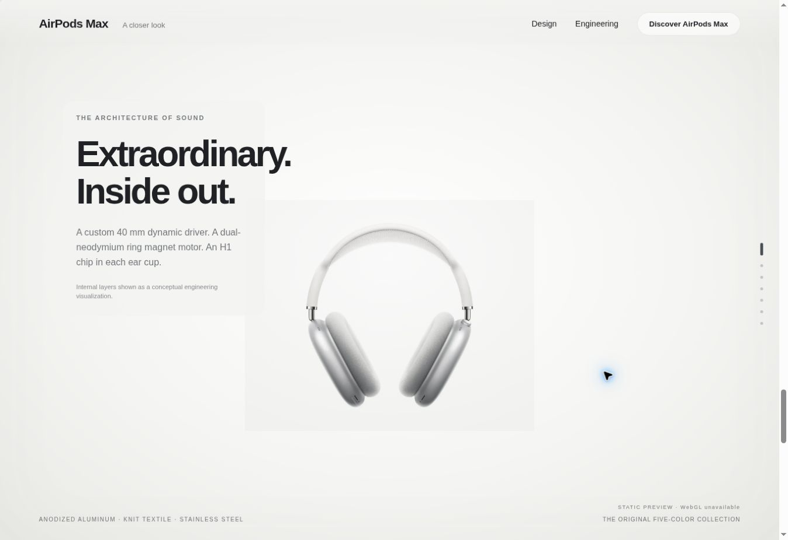
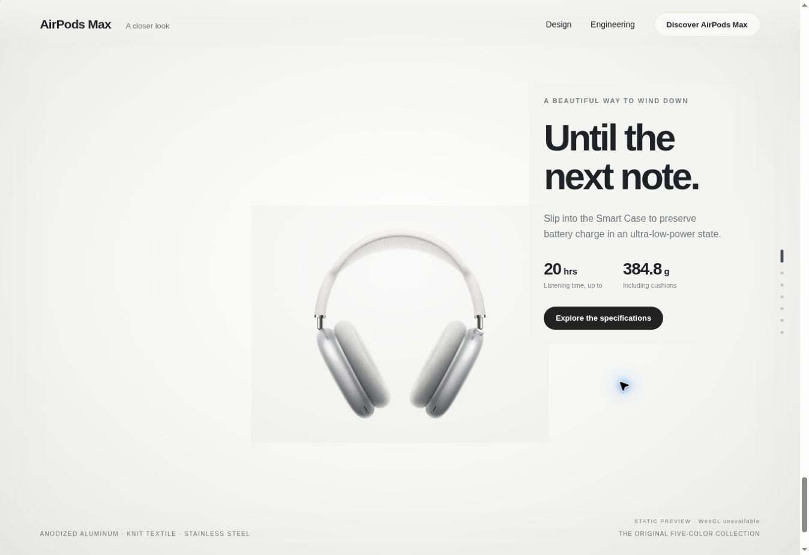

# AirPods Max — A closer look

A self-contained static website, using Three.js ES modules vendored locally. No Spline, remote model, external font, CDN or external texture dependency. Serve `dist/` with any HTTP server.

The original 2020 five-color H1 model is the subject. All geometry and 3D material textures are procedural. The supplied front-view reference is used only for the no-WebGL static fallback.

## Interaction
Scroll through seven stages or use the right-hand chapter navigation. Select one of five finishes at the beginning, in the color chapter, or finale. A manual selection persists. Reduced motion respects the browser preference; the camera follows scroll directly and parallax is disabled.

## Rendering
Physically based materials, procedural textile bump and perforation, bead-blast bump, generated PMREM studio lighting, moving key/rim illumination, delta-smoothed camera/object keyframes, instanced grille perforations and crown knurling. Projected callouts use the actual component world positions. Cushions, electronics, drivers and baffles share the persistent model hierarchy. Case pockets and the hinged flap are separately animated.

## Accuracy and verification
Based on the supplied front, control, exploded, detached-cushion and case references, and Apple’s 2020 launch announcement and original technical specifications. Overall size ratio follows 168.6 × 187.3 mm; the internal layout and Smart Case geometry are interpretations, not production CAD. Not every unmeasured sensor, shell chamfer, fabric detail or case fit can be certified exact. This is an independent product visualization.

The source passed JavaScript syntax checks. The page was reviewed in the provided browser, which has WebGL disabled; actual GPU rendering, visual correctness of 3D poses, mobile rendering and 60fps performance remain unverified. A reference-image fallback is provided for this environment. No claim of measured 60fps or photorealistic parity is made.

Sources: https://support.apple.com/en-in/111858 and https://www.apple.com/newsroom/2020/12/apple-introduces-airpods-max-the-magic-of-airpods-in-a-stunning-over-ear-design/

## Website screenshots

These screenshots show the website’s static fallback as captured in a browser with WebGL disabled. The 3D camera views, color morphing, detached cushions, exploded components, and Smart Case animation are not rendered in these captures.

### Hero

### Five finishes

### Digital Crown and noise control

### Canopy and cushion materials

### Magnetic cushions

### Acoustic engineering

### Smart Case finale

