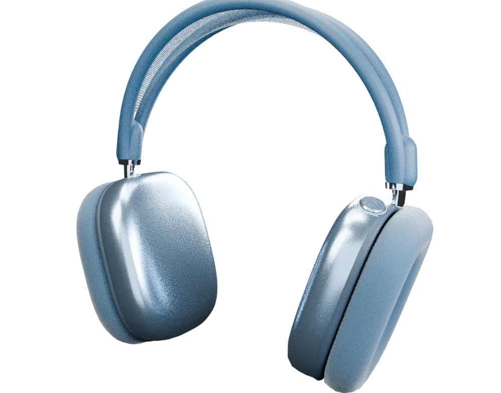
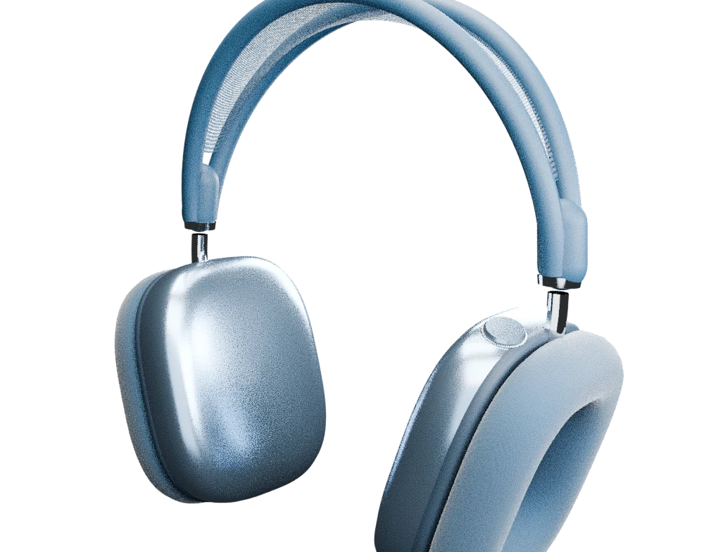
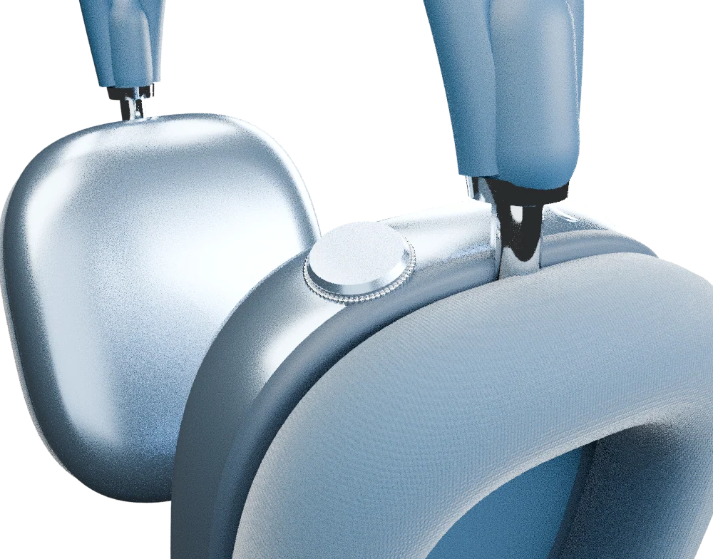
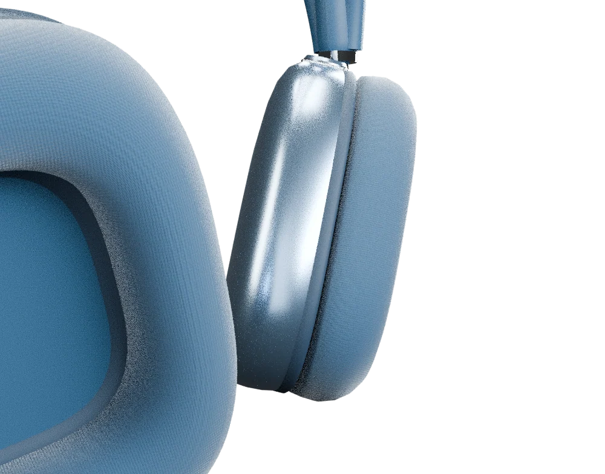
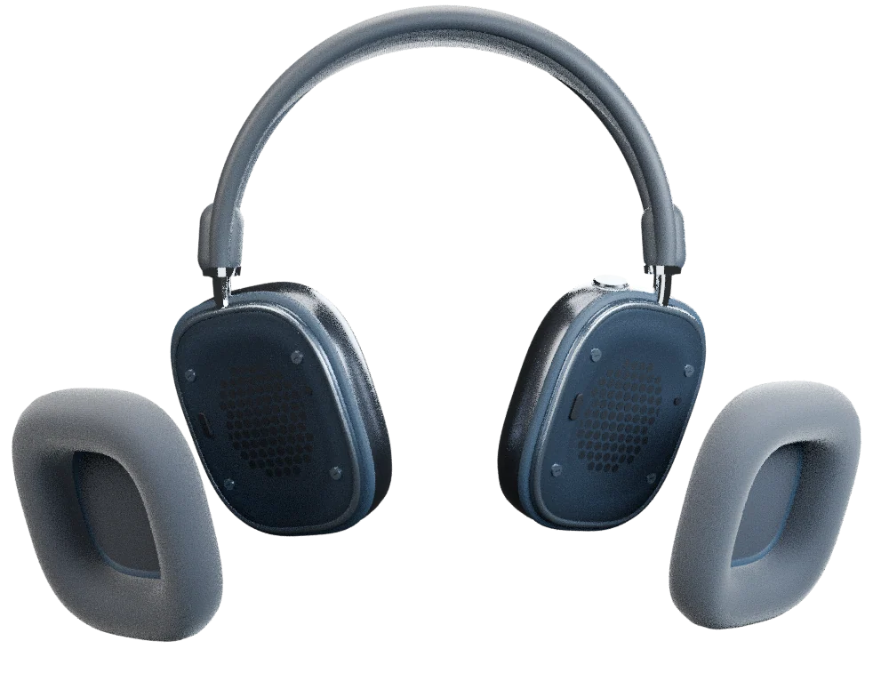
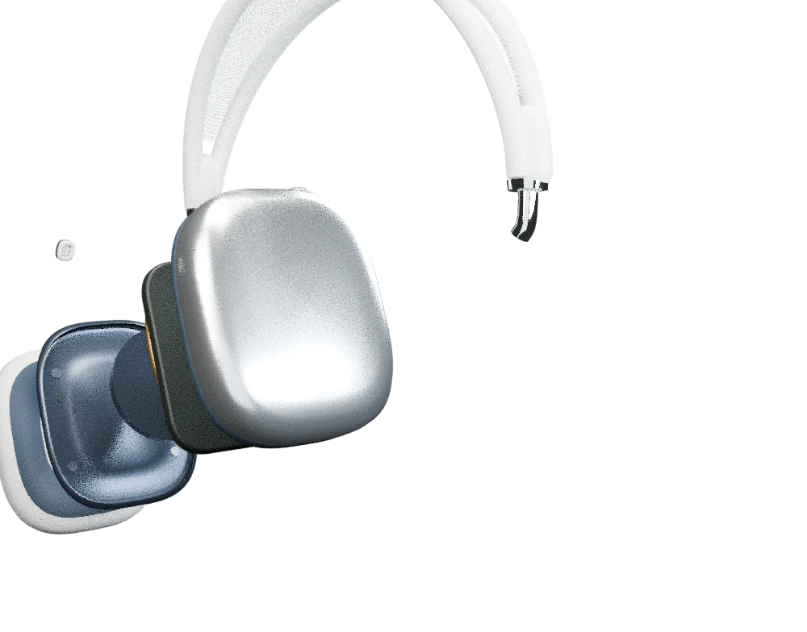
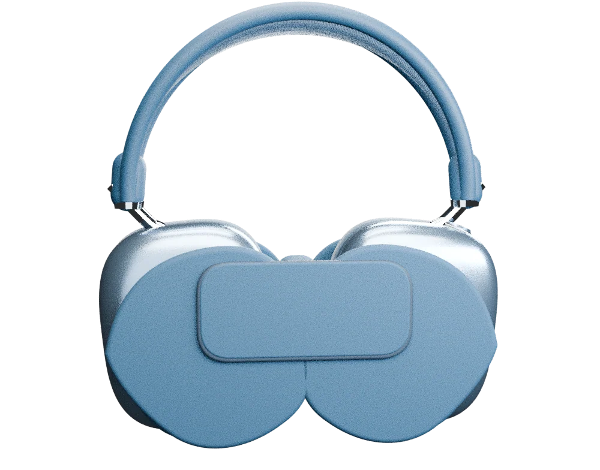

# AirPods Max — Interactive Design Study

A seven-chapter, scroll-driven showcase of the original 2020 AirPods Max. The live page uses one hierarchical Three.js model, custom parametric cup surfaces, procedural material maps, a PMREM studio environment, and projected hardware annotations. The site is a static Vite build and has no external 3D assets or runtimes.

## Showcase gallery

### Overview



### Finishes



### Precision controls



### Knit mesh and cushions



### Magnetic cushion removal



### Exploded ear cup



### Smart Case



## Run locally

```sh
npm ci
npm run dev
npm run build
```

The production build is in `dist/`. Serve it over HTTP with any static host. WebGL 2 enables the live model. Browsers without WebGL 2 receive local stills rendered from the same procedural geometry.

- `src/model.js` builds the headset, acoustic layers, and Smart Case.
- `src/choreography.js` holds camera keyframes and mechanical motion.
- `src/main.js` connects native scroll, rendering, stage navigation, and annotations.
- `scripts/` contains the optional offline still exporter. Run `node scripts/export-stills.mjs /tmp/airpods-frames.json` and `blender -b --python scripts/render-stills.py -- /tmp/airpods-frames.json /tmp/airpods-frames`, then encode the RGBA PNG frames as WebP into `public/stills/`.

The supplied images informed the visual design. The model and cutaway are a design-study reconstruction. Dimensions, finishes, and controls are based on [Apple's original specs](https://support.apple.com/en-in/111858). [Apple's 2020 announcement](https://www.apple.com/in/newsroom/2020/12/apple-introduces-airpods-max-the-magic-of-airpods-in-a-stunning-over-ear-design/) and the [iFixit teardown](https://documents.cdn.ifixit.com/pdf/ifixit/guide_139369_en.pdf) informed the driver and internal layout.
